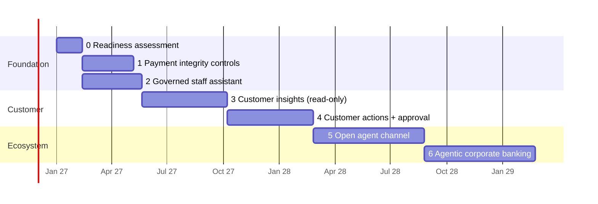
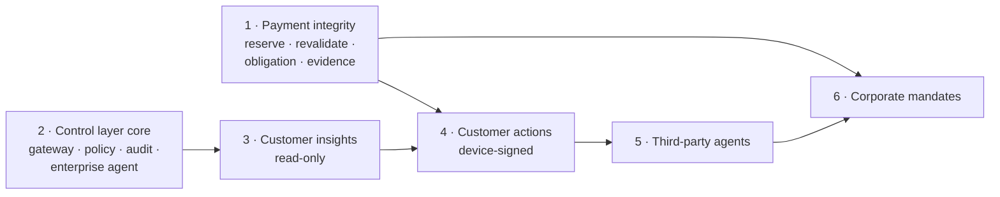

# Safe Agentic Banking — Phased Rollout Proposal for a Bank

| | |
| --- | --- |
| **Document status** | Draft for discussion with a prospective bank. Generic: not yet tailored to a named institution. |
| **Audience** | Bank executive sponsors: CEO / COO, CIO / CTO, CISO, CRO, Head of Digital, Head of Compliance |
| **Date** | 2026-11-17 |
| **Builds on** | [solution-blueprint.md](solution-blueprint.md) (the architecture) · [clearhouse-assessment.md](clearhouse-assessment.md) (commitment controls from the ClearHouse papers) · [development-strategy.md](development-strategy.md) (how OrangePay builds and sells it) |

**How to use this document.** This is the version we put in front of a bank. The blueprint explains *how* the
controls work; this document explains *what the bank gets, in what order, and when it pays back*. Replace the
bracketed items and the indicative durations once the bank's own discovery workshop has been done.

---

## 1. The proposal in one page

**The situation.** Customers, staff and partners are starting to use AI agents to do banking work. Today that
happens without the bank's control: staff paste data into public chatbots, aggregators screen-scrape the mobile
app, and payment and treasury automation already moves money with no human watching each transaction. Regulators
(BNM RMiT, MAS TRM, and MAS's SAFR reference architecture for agent-initiated financial actions) are starting to
ask how banks govern this.

**What we propose.** A single, bank-owned **Agent Control Layer** that every AI agent, internal or external, must
pass through to read bank data or move money. It applies the rule:

> **The agent may suggest; only the bank's own deterministic controls may decide.**

**How we roll it out.** Six phases. **Each phase is funded and approved on its own, delivers value the bank can
measure before the next phase starts, and leaves the bank better off even if it stops there.** The first two
phases deliver value within roughly one quarter and do not expose any customer to AI.

| Phase | What the bank gets | Value starts | Customer exposure |
| --- | --- | --- | --- |
| 0. Readiness assessment | A board-ready view of where AI agents already touch the bank, and a regulator-ready gap map | Week 4–6 | None |
| 1. Payment integrity controls | Duplicate-payment, limit-race and stale-approval protection on **existing** automated payments | Month 3 | None |
| 2. Governed staff assistant | A safe internal AI assistant for operations and service staff, on the same control layer | Month 3–4 | None |
| 3. Customer insights in the app | "How did I spend this month?" inside the bank's app, with no raw data leaving the bank | Month 6–9 | Read-only |
| 4. Customer actions with approval | Agents draft payments; customers approve on their device | Month 9–12 | Write, always customer-signed |
| 5. Open agent channel | Allowlisted third-party agents connect officially, replacing screen scraping | Year 2 | Partner channel |
| 6. Agentic corporate banking | SME / corporate customers' own agents pay within mandates the bank enforces | Year 2+ (hypothesis) | Corporate |

**What we ask for now:** Phase 0 only, a fixed-scope engagement of 4–6 weeks. The decision on Phase 1 is made
with Phase 0's findings in hand.

---

## 2. Value proposition

### 2.1 Why act now

1. **The exposure already exists.** Shadow AI use by staff, screen-scraping aggregators and unattended payment
   automation are present in most banks today. Doing nothing is not a zero-risk option. It is an *ungoverned*
   option.
2. **Customers will arrive with agents.** Assistants that can browse, shop and pay are becoming common. A bank
   that offers a safe, official agent channel keeps the customer relationship. A bank that does not will be
   reached through scraping and unofficial workarounds it cannot see or control.
3. **The costliest failures are in execution, not in the AI.** Public enforcement records show large losses from
   limits that were advisory or missing at the point a payment was committed. They predate AI agents, and they
   are what agents will multiply:

   | Incident | What went wrong | Control class that addresses it |
   | --- | --- | --- |
   | Santander UK, 2021 | ~75,000 payments executed twice (~£130M) | Idempotent, durably recorded payment obligations |
   | Citibank–Revlon, 2020 | ~$900M principal paid instead of ~$8M interest, despite three approvers | Approval bound to the exact payment |
   | Citigroup equities, 2022 | A US$444bn basket entered in error; the FCA found an overridable warning, no hard block | Non-overridable limits |
   | Barclays over-issuance, 2021–22 | $17.7bn issued past a fixed limit with no real-time tracking | Atomic reserve-then-commit against shared limits |
   | Knight Capital, 2012 | ~$460M lost in 45 minutes of unbounded automated orders | Independent aggregate exposure cap |

   Source: incident register in *Governing Agentic Finance* v3.5 ([reference/](reference/)), ch. 7. These are
   conditional assessments of control types, not claims that a specific product would have prevented them.

4. **Regulators are writing the vocabulary.** MAS's SAFR describes four outcomes for every agent action (Deny,
   Escalate, Auto-Execute, Observe). Building to that vocabulary now makes later supervisory conversations
   shorter. (To be confirmed against the MAS source and any BNM equivalent in Phase 0.)

### 2.2 What each executive gets

| Stakeholder | Value |
| --- | --- |
| **CEO / Board** | A credible, staged answer to "what is our AI agent strategy, and is it safe?" Each step is small enough to approve and stop. |
| **Head of Digital** | A path to agentic customer features (insights, payments, partner agents) without waiting for every risk question to be solved first. |
| **COO** | Fewer payment incidents and manual investigations; staff productivity from a governed assistant; contact-centre deflection once customer features go live. |
| **CISO** | One choke point for all agent traffic: least-privilege tools, no raw data in third-party models, kill switch, signed evidence. Removes shadow AI rather than policing it. |
| **CRO** | Hard limits that cannot be raced, overridden or approved on stale information; uncertain payments tracked rather than retried. Applies to existing automation from Phase 1. |
| **Compliance** | Every agent decision explained with the rule and policy version that made it; tamper-evident evidence an auditor can verify offline; mapping to PDPA / GDPR, RMiT / TRM and SAFR. |
| **CIO / CTO** | One reusable platform instead of a separate integration per AI initiative. Built on the bank's existing IAM, API gateway, database and HSM. |

### 2.3 Why this approach rather than alternatives

| Alternative | Limitation |
| --- | --- |
| Ban AI agents | Does not stop shadow use or scraping; forfeits the channel to competitors. |
| Rely on an AI firewall / prompt scanner | Probabilistic. Catches some attacks, misses a well-crafted one, and does nothing about limit races or duplicate payments. We integrate scanners as one layer, not the defence. |
| Rely on rate limiting and the existing API gateway | Stops volume abuse, not one authorised-looking bad request. |
| Let each AI project build its own controls | Repeated cost, inconsistent controls, no single evidence trail. |
| Buy a separate agent-execution runtime | Within one bank, standard database engineering does the same job faster (the ClearHouse authors' own finding). We build those controls into the bank's own stack. |

### 2.4 What makes it low-risk to start

- **Phases 0–2 involve no customer-facing AI.**
- **Every write is customer-signed** until the bank explicitly decides otherwise (Phase 6 at the earliest).
- **Model-agnostic and vendor-agnostic:** the bank's approved models, IAM, policy engine and scanners.
- **Each phase has a gate** with pre-agreed success measures. The bank keeps what it has built if it stops.

---

## 3. The phases

Dates are illustrative, assuming a January start. Phases 1 and 2 run in parallel. Durations are planning
assumptions, to be fixed after Phase 0.

### Phase 0 — Agentic AI readiness assessment (4–6 weeks)

**Scope**
- Inventory where AI agents and automation already touch the bank: staff AI use, scraping traffic on digital
  channels, RPA bots, payment and treasury automation, vendor AI features.
- Threat-model workshop using the blueprint's threat catalogue (T1–T9) against the bank's own architecture.
- Regulatory gap map: PDPA, RMiT / TRM, SAFR, outsourcing rules for external models.
- Payment-integrity review of one existing automated payment flow: can it double-pay, race a limit, or execute on
  a stale approval?
- Prioritised roadmap and business case for Phases 1–2.

**Value delivered immediately:** a board paper on AI agent exposure; a regulator-ready gap map; a concrete list
of payment-integrity weaknesses in existing automation. Useful even if the bank never goes further.

**Investment:** small. 2–3 OrangePay consultants; ~10 days of bank SME time.

**Gate:** sponsor agrees the Phase 1 and 2 business case and success measures.

### Phase 1 — Payment integrity controls on existing automation (~3 months)

The commitment controls from the blueprint (4.5) and the ClearHouse papers, applied first to automation the bank
already runs: bulk payment files, RPA bots, scheduled sweeps or treasury tools. **No AI is required to get the
value.**

**Scope**
- Reserve-then-commit against shared limits (per account, per customer, per desk), so parallel processes cannot
  jointly exceed a limit.
- Re-check approvals at execution time: a payment approved before a hold, freeze or limit change is refused.
- Durable payment obligations with idempotency keys: a crash or timeout never produces a second payment; uncertain
  outcomes go to an operations queue instead of being retried.
- Signed, offline-verifiable evidence of every decision.
- Policy decisions labelled Deny / Escalate / Auto-Execute / Observe.

**Value delivered:** fewer duplicate payments and limit breaches, faster investigations, and audit evidence for
one real flow. This is the foundation every later agent phase reuses.

**Success measures (examples):** 0 duplicate payments and 0 limit breaches under injected crash and concurrency
tests; time to investigate a disputed payment; % of decisions with verifiable evidence.

**Investment:** medium. 2–3 engineers plus an architect; bank payments and operations SMEs.

### Phase 2 — Governed staff assistant (~3–4 months, parallel to Phase 1)

**Scope**
- The Agent Control Layer core: MCP gateway, policy-as-code, least-privilege read-only tools, bank-hosted
  enterprise agent with no internet egress (blueprint Pattern C), append-only audit.
- One or two internal use cases with measurable time savings, for example: contact-centre agents summarising a
  customer's recent activity and open cases; operations staff investigating payment exceptions (reusing Phase 1's
  obligation records); policy and procedure Q&A.
- Replace shadow AI use with an approved route; monitor and block unapproved AI endpoints.

**Value delivered:** staff productivity on day one of go-live, inside the bank's own perimeter; shadow-AI risk
reduced. Proves the control layer with the bank's own staff before customers see it.

**Success measures (examples):** average handling time or investigation time for the chosen process; adoption;
0 data leaving the bank's controlled models; 100% of tool calls audited.

**Investment:** medium. 2–3 engineers, a security architect, the bank's model-hosting team.

### Phase 3 — Customer insights in the bank's app (~4–6 months)

**Scope**
- Read-only agent features in the bank's own app: spending summaries, "can I afford…", subscription and fee
  explanations.
- Raw transactions never reach an external model: analysis happens in the bank-hosted enterprise agent; full
  statements are shown through blind tokens redeemed in the app (blueprint Patterns B and C).
- Account-level consent screens; injection scanning on uploaded documents (Pattern A).
- Red-team test pack (S1–S3) run by the bank's security team before launch.

**Value delivered:** a visible AI feature for customers, engagement uplift, contact-centre deflection for
balance and spending questions. No money movement yet.

**Success measures (examples):** active users; deflected contacts; customer satisfaction; 0 data exfiltrations
in red-team testing.

**Investment:** medium–large. Adds mobile / app team effort and customer UX testing.

### Phase 4 — Customer actions with device approval (~4–6 months)

**Scope**
- Agents can *draft* bill payments, own-account transfers and payments to existing payees. The customer approves
  on their device with a biometric-unlocked key over the bank-rendered details (blueprint Pattern D).
- The Phase 1 commitment controls now protect agent-initiated payments too: reserve, re-check at execution,
  durable obligation, evidence.
- Anomaly response and kill switch integrated with the SOC.
- New payees, limit changes and high-risk actions stay out of scope or get extra friction.

**Value delivered:** transactions completed conversationally inside the bank's channel; digital share of
servicing up; every write still customer-signed.

**Success measures (examples):** task completion; payment volume via the agent; 0 writes without a valid customer
signature; 0 stale or duplicate executions.

**Investment:** medium. Mostly reuse of Phases 1–3.

### Phase 5 — Open agent channel for third parties (~6 months)

**Scope**
- Allowlisted external agents (fintechs, aggregators, customers' personal assistants) connect to the bank's MCP
  server with registered identities, sender-constrained OAuth tokens and per-account consent.
- They receive aggregates or blind tokens, never raw history; any write becomes a Phase 4 draft the customer
  signs in the bank's app.
- Partner onboarding, contracts and commercial terms.

**Value delivered:** replaces screen scraping with a governed, observable channel; positions the bank for open
finance; possible partner fee revenue.

**Investment:** medium. Mainly partner onboarding, legal and commercial work.

### Phase 6 — Agentic corporate banking (later; hypothesis to test with the bank)

**Scope**
- SME and corporate customers' own agents pay suppliers, sweep cash or settle invoices under **mandates** the
  bank enforces: spending envelopes, counterparty lists, shared budgets across several agents and channels.
- Auto-Execute within the mandate; Escalate above it; signed evidence the customer's auditor can verify.

**Value delivered:** a new fee-earning corporate product built on the Phase 1 controls. Only pursued if Phase 0
discovery and corporate-client interviews show demand.

---

## 4. How value builds up

Nothing is thrown away. Phase 1's commitment controls protect every payment in Phases 4–6; Phase 2's gateway,
policy engine and audit store serve every agent in Phases 3–6. Each later phase costs less than the one before
it, because more of the platform already exists.

| Value type | Phase 0 | 1 | 2 | 3 | 4 | 5 | 6 |
| --- | --- | --- | --- | --- | --- | --- | --- |
| Risk reduction | ● | ● | ● | ● | ● | ● | ● |
| Regulatory readiness / evidence | ● | ● | ● | ● | ● | ● | ● |
| Operating cost / productivity | | ● | ● | ● | ● | | |
| Customer experience | | | | ● | ● | ● | |
| New revenue | | | | | | ● | ● |

---

## 5. Commercial model and governance

**Commercial model (to agree with the bank)**
- Phase 0: fixed fee.
- Phases 1–2: fixed-scope delivery fee, plus a platform licence that starts at go-live.
- Phases 3–6: per-phase delivery fee; licence scaled by active users or agent calls.
- Each phase is a separate order. No commitment beyond the current phase.

**Governance**
- An executive sponsor and a steering group (Digital, Technology, Security, Risk, Compliance) meeting at each gate.
- Success measures agreed and written down *before* each phase starts; results reported at the gate whether
  they are good or bad.
- The bank's security team runs the red-team pack and the bypass drills against its own deployment. We supply
  them; the bank does not need to take our word.

**What we need from the bank**
- An executive sponsor and a named product owner.
- Access to a non-production environment and synthetic or masked data.
- SME time from payments operations, security, compliance and (from Phase 3) the app team.
- Its approved model-hosting option, IAM / OAuth server, policy engine choice and HSM.

---

## 6. Honest limits

- **The architecture is not yet proven at a bank.** The blueprint has not been reviewed by a bank's security,
  architecture or compliance team. Phase 0 and the Phase 1–2 gates exist to test it with this bank's own systems.
- **The ClearHouse evidence is the authors' own.** The commitment controls draw on two self-published, AI-assisted
  papers with no independent review. Their mechanisms (reservation, revalidation, durable obligations,
  idempotency, signed logs) are long-established engineering patterns. That is why we are confident building them
  into the bank's stack. We are not relying on their software.
- **Within one bank, these are known techniques.** The value is in applying them consistently to every agent and
  every automated payment, with one evidence trail, not in novelty.
- **Customers can still be socially engineered** into approving a bad payment. Device-signed approval stops the
  agent acting alone. It does not stop a determined fraudster persuading a customer. Friction and warnings on
  high-risk patterns reduce this risk; they do not remove it.
- **Regulatory alignment is a design posture, not a certification.** The bank's compliance team signs off the
  mapping.

---

## 7. Proposed next step

A 60-minute session with the sponsor and CISO to agree Phase 0 scope, followed by a 4–6 week readiness assessment
and a Phase 1–2 business case brought back to the steering group.
