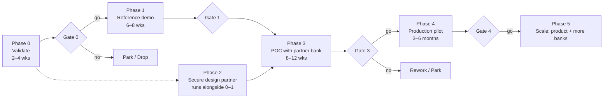

# Securing AI Agents and MCP in Banking — Development Strategy

How we would go from [solution-blueprint.md](solution-blueprint.md) to a proof of concept (POC) with a partner bank,
and then to a repeatable product. Status: proposal, before Validation. Durations are rough planning assumptions,
not estimates. See the [project tracker](README.md).

## 1. What we would actually sell

| Offer | What it is | Cost to us | Reuse across banks | Role |
| --- | --- | --- | --- | --- |
| **A. Blueprint and advisory** | The blueprint adapted to a bank: threat-model workshop, gap assessment against their stack, compliance mapping | Low | High (the method) | **Door-opener.** Sellable now, finds the design partner. |
| **B. Agent Security Gateway** (software) | MCP gateway + policy-as-code + audit trail + HITL orchestration + least-privilege tool kit + red-team test pack | Medium–high | **High** | **The product.** Our core IP. |
| **C. Integration accelerators** | Blind-token vault and app redemption (Pattern B), enterprise-agent sandbox (Pattern C), wired into the bank's core and mobile app | High per bank | Medium | Delivered per bank as a services engagement. |

**Recommendation:** lead with A, build B, and deliver C during the POC.

Offer B is where the blueprint is *deterministic and bank-agnostic*: Section 4 (OAuth binding, tool design,
policy gateway), Section 5 (audit, anomaly response) and the orchestration side of Pattern D. Offer C depends on
each bank's core banking system and mobile app, so it only becomes reusable after two or three deployments.

**Build vs partner:**

| Component | Approach |
| --- | --- |
| Pattern A scanners / AI firewall | **Partner / integrate.** Don't build classifiers. Make the gateway pluggable so a bank can use its preferred vendor. |
| Policy engine | Use an existing engine (OPA or Cedar). Our value is the banking policy library on top. |
| Models | Whatever the bank approves. The design is model-agnostic. |
| Authorisation server | The bank's existing IAM / OAuth server, extended with consent screens. We supply the profile and configuration. |
| Gateway, tool kit, intent schemas, audit schema, HITL orchestration, red-team pack | **Build.** This is the IP. |

## 2. Phases and gates

Each gate is a Build / Park / Drop decision recorded in the tracker, in line with the
[project process](../00%20-%20Project%20Process/README.md).

### Phase 0: Validate (2–4 weeks, low cost)

Goal: confirm that banks feel this pain now, that someone owns a budget for it, and that the gap is not already
filled by an existing vendor.

- Desk research:
  - Survey the market: AI firewalls / prompt-security vendors, MCP gateways, API-gateway vendors adding AI
    features, core-banking vendors' AI roadmaps.
  - Survey the regulators: current BNM and MAS technology-risk and AI guidance; any sandbox programmes open to
    agentic AI.
- **5–10 discovery conversations** with bank CISOs, enterprise architects, digital-channel heads and AI programme
  leads. Questions:
  - Are you exposing anything to AI agents yet?
  - What stopped you?
  - Who would sign off?
  - Would you run a POC on synthetic data?
- Get a security practitioner outside OrangePay to review the blueprint for credibility.

**Partner touchpoint:** use warm introductions from existing OrangePay relationships, including the MDEC / Johor
contacts from [project 01](../01%20-%20Johor%20Digital%20Government%20Next%20Steps%20(China%20Benchmark)/README.md)
for introductions into the Malaysian ecosystem.

**Gate 0 (go if):** at least 3 banks confirm the problem is a priority within 12 months, and **at least 1 is
willing to talk POC.** No dominant vendor already solves the whole stack.

### Phase 1: Reference demo (6–8 weeks)

Goal: a working, self-hosted demonstration. It becomes the main sales asset and the base for the POC.

- A mock core-banking system with synthetic customers and accounts, including joint and business accounts (for S1)
  and memos with injection payloads (for S2).
- An MCP server with least-privilege tools (4.2). The gateway uses policy-as-code (4.3), OAuth with PKCE and
  DPoP (4.1), and writes an append-only audit log (5.1).
- Pattern D with a simple mock "bank app" (mobile web or a thin native shell) that does device-key signing.
- Pattern C as a minimal sandboxed enterprise agent for one intent (`spending_summary`).
- Pattern B as one blind-token journey (`statement_view`).
- One Pattern A vendor integrated through the pluggable interface.
- **Red-team demo script:** replay S1–S3 against a naive agent setup (the attacks succeed), then against the
  blueprint stack (they are blocked). Show the audit trail for each one.

**Partner touchpoint:** approach Pattern A vendors and a cloud provider's financial-services team about
technology partnerships (credits, co-marketing, joint pitches).

**Gate 1 (go if):** the demo reliably blocks S1–S3 live. We know the gateway's latency overhead. Phase 0 contacts
respond well to the demo.

### Phase 2: Secure a design-partner bank (alongside Phases 0–1)

**Target profile for the first partner:** decides quickly, is cloud-native or has modern APIs, is actively
building an AI assistant, and has a security team willing to co-design. Licensed **digital banks** and the
**innovation / digital labs of incumbent banks** fit best. Tier-1 core-banking teams are a Phase 5 target, not a
first POC.

**Where to find one:**

| Channel | How it helps | What we offer |
| --- | --- | --- |
| Digital banks (MY and SG digital-bank licensees) | Fast decisions, AI-first roadmaps | A low-cost POC in exchange for co-design and reference rights |
| Incumbent bank innovation labs | Budget for experiments; a path to the main bank | A safe, synthetic-data POC that their CISO can approve |
| Regulatory sandboxes (BNM Regulatory Sandbox, MAS FinTech Regulatory Sandbox) | Regulator visibility and credibility; lowers the bank's perceived risk | A joint application with the partner bank |
| Industry forums and events (fintech associations, Singapore FinTech Festival, bank CISO roundtables) | Pipeline and credibility | A talk or demo of the S1–S3 red-team |
| Core-banking vendors and system integrators | Already own the integration and the client relationship | A channel partnership: our gateway in their delivery |
| Cloud providers' financial-services teams | Introductions to their banking customers; possible POC funding | A reference architecture on their platform |
| Existing OrangePay clients and network | Warm trust | Advisory (Offer A) as the entry point |

**Partnership terms to have ready:**
- NDA and POC statement of work with written success criteria;
- a data-handling clause (synthetic or masked data only in the POC);
- IP ownership (the gateway stays ours; bank-specific integration is shared or licensed);
- reference and case-study rights;
- a pre-agreed price for a paid pilot if the POC passes.

**Gate 2:** a signed POC agreement with agreed success criteria.

### Phase 3: POC with the partner bank (8–12 weeks)

Environment: the partner's **non-production** environment, or our hosted environment connected to their sandbox
APIs. Synthetic or masked data only.

**Scope:** three journeys, one per core pattern:
1. **Analysis (Pattern C):** "How is my spending this month?" through the enterprise agent.
2. **View (Pattern B):** "Show me my statement," through a blind token redeemed in the partner's app (or a mock
   app, if their app team cannot join in the POC window).
3. **Action (Pattern D):** a bill payment or own-account transfer draft, approved with a device-bound signature
   against their sandbox core.

**Success criteria** (to be agreed with the partner; the targets below are starting proposals):

| Criterion | Target |
| --- | --- |
| Red-team test pack (S1–S3, T1–T6), run by the partner's security team | 0 successful data exfiltrations; 0 unauthorised state changes |
| Writes executed without a valid customer signature | 0 (100% go through Pattern D) |
| Tool calls with an audit record and policy decision | 100% |
| Gateway latency overhead | p95 target agreed with the partner |
| Task completion in user testing | Agreed baseline (measures the friction from Patterns B and D) |
| Compliance mapping (5.3) | Reviewed and signed off by the partner's compliance team |

**Deliverables:** a POC report, the threat model updated for the partner's stack, a gap list for production, and a
pilot proposal with costs.

**Gate 3 (go if):** the success criteria are met, and the partner sponsors a paid pilot.

### Phase 4: Production pilot (3–6 months, paid)

- Production deployment for a limited cohort: **bank staff first, then opt-in customers.** Start read-only
  (Patterns B and C) and enable writes (Pattern D) once the read path is stable.
- Pre-go-live:
  - independent penetration test;
  - SOC integration for anomaly alerts and the kill switch;
  - runbooks and incident playbooks;
  - SLAs.
- The bank runs any regulator notification or consultation needed. We supply the architecture and assurance
  evidence.
- Measure for the Outcome section: adoption, task completion, blocked-attack telemetry, incidents, and the
  operations cost per active user.

**Gate 4 (go if):** the pilot runs with no material incidents, and the bank commits to full rollout or a
multi-year licence.

### Phase 5: Scale (bigger goals)

- **Productise Offer B:** a multi-tenant SaaS option for smaller institutions, and an on-premises / private-cloud
  deployment for Tier-1 banks. Publish the policy library and the intent-schema catalogue.
- **More banks:** use the pilot bank as a reference. Next, a second bank in the same market and then a Tier-1
  bank. Then a second market (MY ↔ SG, then wider ASEAN).
- **Third-party agent access:** extend from the bank's own assistant to allowlisted external agents. This matches
  open-finance and open-banking directions.
- **Certifications:** ISO 27001 and SOC 2 Type II for our own operations, plus security assessments that banks'
  vendor-risk processes require.
- **Standards and visibility:** contribute to MCP authorisation and security discussions, and publish the S1–S3
  red-team pack.
- **Pricing (to validate):** a per-bank platform licence plus usage (active users or tool calls), plus advisory
  and integration fees for Offers A and C.

## 3. Partner touchpoints at a glance

| Phase | Partner type | We ask for | We give |
| --- | --- | --- | --- |
| 0 | Bank CISOs and architects, network contacts | 30–45 min discovery, a blueprint critique | Early access to the blueprint |
| 1 | Pattern A vendors, cloud providers | Licences or credits, technical support | A reference integration, co-marketing |
| 2 | Digital banks, innovation labs, sandboxes, SIs | A POC commitment, a joint sandbox application | A low-cost POC, co-design input |
| 3 | The partner bank's security and compliance teams | Red-teaming, compliance review | The POC report, the threat model |
| 4 | The partner bank, the regulator (via the bank) | A paid pilot, production access | The production gateway, assurance evidence |
| 5 | SIs, core-banking vendors, more banks | Distribution, references | Product, partner margin |

## 4. Team and capabilities needed

- **Phases 0–1:** 1 solution / security architect (blueprint, discovery, demo narrative), 1–2 backend engineers
  (gateway, MCP server, OAuth/DPoP, policy, audit), part-time mobile or front-end help (mock app with device-key
  signing).
- **Phase 3 and later:** add an integration engineer for the bank's core and app, a security tester (internal or
  contracted), and someone with banking-compliance experience (advisory or contract).
- Engineer hours are tracked in the external time-tracking tool, not here.

## 5. Strategy risks

| Risk | Mitigation |
| --- | --- |
| Long bank sales cycles (often 6–18 months) | Start with digital banks and labs; use Offer A to earn revenue while waiting; use sandbox programmes. |
| Large vendors (API gateways, cloud, core-banking) add "AI agent security" to their products | Position as the banking-specific policy, HITL and blind-token layer that sits *on top of* their gateways. Pursue SI and vendor channel deals. |
| MCP and OAuth 2.1 specifications change | Use a thin protocol adapter layer and pin versions. Treat spec tracking as ongoing work. |
| Regulator position on customer-facing agents is unclear or restrictive | Run the POC through a sandbox; design so the bank can show compliance (5.3). |
| Liability if a protected flow fails | Contract terms, insurance, and the deterministic design: writes always need a customer signature. |
| Unproven assumption: banks want this *now* | Gate 0 exists to test it cheaply before any build spend. |

## 6. Immediate next steps

1. Name an owner for the project (the tracker currently says TBC).
2. Write the list of 10 discovery targets and the warm-introduction path for each.
3. Run the market and regulator desk research (Phase 0). Record the findings in a `research/` folder in this project.
4. Get the blueprint reviewed by one outside security practitioner.
5. Hold Gate 0 and record the decision in the tracker.
