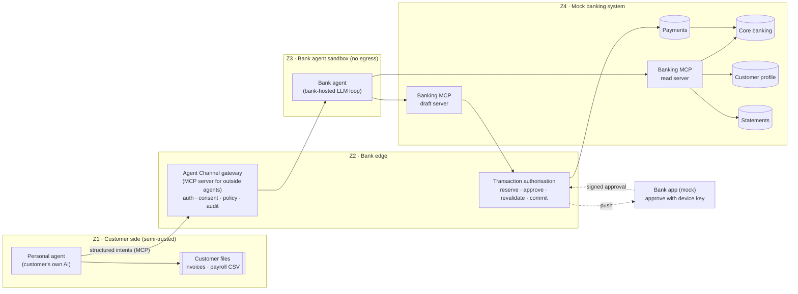

# Securing AI Agents and MCP in Banking — Agentic Banking POC

A working proof of concept with three parts: a **personal agent** (the customer's own AI agent), a **bank agent**
(the bank's enterprise agent), and a **mocked banking system** that the bank agent reaches only through MCP. It is
the Phase 1 "reference demo" in [development-strategy.md](../development-strategy.md), aimed at showing **what the
bank agent can do**, for both retail and corporate customers, while the controls in the
[solution blueprint](../solution-blueprint.md) stay in place. See the [project tracker](../README.md).

Status: **draft for review, nothing built yet.** Created 2026-11-19.

## The idea in one picture

- The **personal agent never touches banking tools.** It speaks to the bank through one MCP server at the bank's
  edge, the *Agent Channel*, using typed intents ("spending summary", "pay this invoice").
- The **bank agent** does the work inside the bank. It is the only agent that uses the **Banking MCP** servers,
  which wrap the mock core banking, customer profile, statements and payments services.
- **The POC can also run without the bank agent**, to show what it adds. Three modes: an unsafe open MCP, the
  personal agent calling governed banking MCP tools directly through the gateway, and the full bank-agent setup
  ([architecture.md](architecture.md) §2a, [demo-script.md](demo-script.md) Act 4).
- **Fraud controls are shown, not just described:** changed bank details on an invoice, an impersonation scam,
  payroll diversion, account takeover and a money mule, plus proof that the agent can't be talked out of a risk
  ([bank-agent-design.md](bank-agent-design.md) §5).
- **Nothing moves money without a signed approval** in the mock bank app, except corporate payments that fall
  inside a mandate the company set up beforehand (SAFR "Auto-Execute"), which is a corporate-only scene.

## Files in this folder

| File | What it is |
| --- | --- |
| [poc-build-prompt.md](poc-build-prompt.md) | **The prompt.** Hand it to a coding agent to build the stack, milestone by milestone. |
| [architecture.md](architecture.md) | Components, trust zones, request flows, tech stack and what the POC simplifies on purpose. |
| [mock-banking-system.md](mock-banking-system.md) | The mock bank systems (core banking, customer profile, statements, payments, fraud intelligence): data model, internal APIs, business rules, seed data. |
| [bank-agent-design.md](bank-agent-design.md) | **How risk is handled.** How the bank agent processes a request, and how each security threat, agent risk and fraud type is mitigated, with the scene that demonstrates it. The document to share with a bank's risk, fraud and security teams. |
| [mcp-tool-catalogue.md](mcp-tool-catalogue.md) | The Banking MCP tools (for the bank agent) and the Agent Channel intents (for personal agents). |
| [use-cases.md](use-cases.md) | Retail (R1–R8) and corporate (C1–C8) use cases, plus the security scenes they exercise. |
| [demo-script.md](demo-script.md) | The scripted demo: scenes, what the audience sees, what to show in the audit trail. |
| [stack/](stack/) | The empty project structure the build fills in. Each folder has a README saying what goes there. |

## Decisions for review before building

These are the recommendations the prompt currently assumes. Change them here and in the prompt together.

| # | Decision | Recommendation | Why | Alternative |
| --- | --- | --- | --- | --- |
| D1 | Language | **Python 3.12** for everything except the browser UI | One language across services, MCP servers and agents; mature MCP and Anthropic SDKs | TypeScript throughout |
| D2 | Where the code lives | `stack/` in this folder for now | You asked for it here; easy to review next to the spec | A separate code repo once the build starts (recommended before it gets large) |
| D3 | How the personal agent talks to the bank | **MCP** (the Agent Channel is an MCP server exposing intent tools) | Same protocol on both sides; any MCP-capable agent can connect | Google A2A protocol between the two agents |
| D4 | Agent loops | **Self-hosted Messages API loop** (Anthropic SDK tool runner) for both agents | The bank agent must run inside the bank's zone with no egress; hosting it ourselves is the point | Anthropic Managed Agents for the personal agent only |
| D5 | Model | `claude-opus-5-5` for both agents, set in config | Current default; cheaper models can be tried per agent once the demo works | `claude-sonnet-5-5` for the personal agent |
| D6 | Policy engine | **Policy-as-code in a versioned Python module** | Fast to build and test; the policy *version* still goes into signatures and audit | OPA / Cedar (blueprint 4.3); swap in for the partner POC |
| D7 | Auth | **Simplified OAuth**: mock auth server, consent screen, short-lived JWT with account and capability scopes | Shows consent scoping (the S1 fix) without a full FAPI build | Full OAuth 2.1 + PKCE + DPoP (blueprint 4.1) as a stretch milestone |
| D8 | Data store | One **Postgres 16**, one schema per mock service, plus one for TAS and audit | Serializable transactions for the commitment layer (blueprint 4.5) | SQLite (cannot show the concurrency scenes honestly) |
| D9 | Pattern A scanning | A **pluggable scanner interface** with a simple built-in heuristic scanner | Proves placement; vendor choice comes later | Integrate one vendor scanner now |
| D10 | UI | One **demo console** web page: personal-agent chat, phone-frame bank app, live audit trail | The audience sees all three at once | Separate apps |
| D11 | Comparison modes | **Three modes** (open / governed direct / bank agent) as one setting; same personal agent code | Separates what the gateway gives from what the bank agent gives; Mode 2 matches board deck Option A, Mode 3 Option C | Only the unsafe baseline vs the target (loses the honest middle) |

## Open questions

1. Who is the audience for the first demo: internal, a bank prospect, or the board? It changes how much polish
   [demo-script.md](demo-script.md) needs.
2. Should the corporate scenes use Malaysian rails names (DuitNow, IBG, JomPAY) as the spec does, or stay generic?
3. Is an Anthropic API key with enough budget available for repeated demo runs? (Each full run of the demo script
   is a few dozen model calls.)
4. The three-mode comparison: Mode 2 arrives at M4, Mode 1 (the unsafe baseline) at M7. Should Mode 1 come
   earlier for a security audience?
