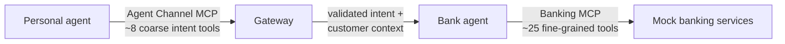
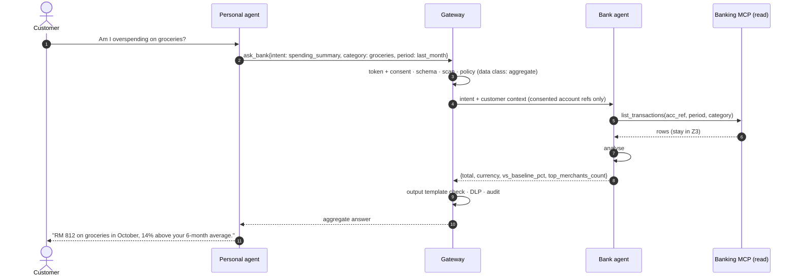
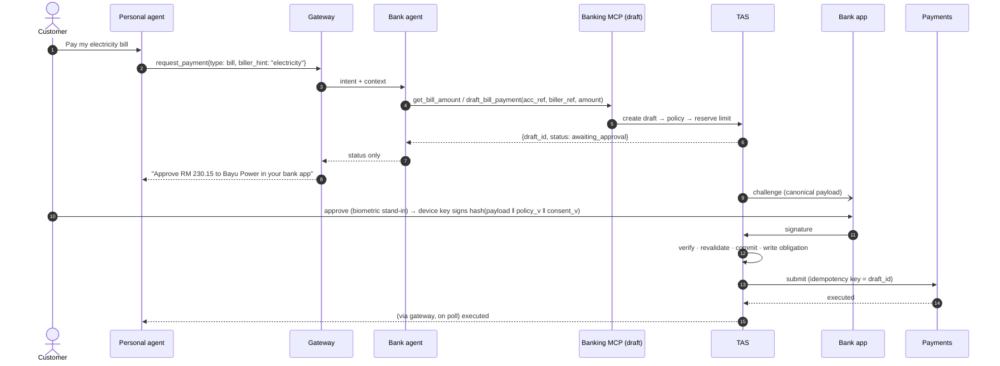

# Agentic Banking POC — Architecture

How the POC stack fits together. It is a cut-down build of the [solution blueprint](../solution-blueprint.md):
the same trust zones and patterns, with the parts that need a real bank (FAPI, HSMs, a real mobile app) replaced by
simple stand-ins. See the [POC README](README.md).

## 1. Components and trust zones

| Zone | Component | Folder | Job |
| --- | --- | --- | --- |
| Z1 | **Personal agent** | `stack/personal-agent/` | The customer's own AI. Chats with the user, reads the user's local files (invoices, payroll CSVs), turns requests into Agent Channel intents. Knows nothing about bank internals. |
| Z0 | **Bank app (mock)** | `stack/bank-app/` | Phone-frame web app. Shows pending approvals rendered from the bank's canonical payload, signs with a device key (WebCrypto ECDSA P-256), redeems blind tokens to show statements. Corporate users get a maker/checker queue. |
| Z2 | **Auth server (mock)** | `stack/bank-edge/auth/` | Login as a seeded customer, consent screen (which accounts, which capabilities), issues short-lived JWTs. Revocation endpoint. |
| Z2 | **Agent Channel gateway** | `stack/bank-edge/gateway/` | The only MCP server outside agents can reach. Checks token and consent, validates intents against schemas, runs the Pattern A scanner, calls the policy engine, forwards to the bank agent, filters the answer on the way out, writes audit. |
| Z2 | **Policy engine** | `stack/bank-edge/policy/` | Versioned rules: consent and scope, data-class ceilings per intent, limits, cooling-off, velocity, corporate mandates and approval matrices. Returns Deny / Escalate / Auto-Execute / Observe with a rule ID and policy version. |
| Z2 | **Transaction authorisation service (TAS)** | `stack/bank-edge/tas/` | Owns the life of every write: draft → reserved → approved → committed → submitted → executed / outcome-unknown (blueprint 4.5). Sends approval challenges to the bank app and verifies signatures. |
| Z2 | **Audit store** | `stack/bank-edge/audit/` | Append-only, hash-chained, signed (Ed25519) events. Evidence-bundle export and an offline verifier CLI. |
| Z3 | **Bank agent** | `stack/bank-agent/` | The bank's enterprise agent. Takes one validated intent with a customer-bound context, plans and calls Banking MCP tools, analyses inside the sandbox, returns a schema-shaped result. No internet egress, no memory across requests. |
| Z4 | **Banking MCP — read server** | `stack/banking-mcp/read-server/` | Read-only tools over the mock services (balances, transactions, profile, statements). |
| Z4 | **Banking MCP — draft server** | `stack/banking-mcp/draft-server/` | `draft_*` tools only. Each creates a TAS draft; none moves money. Separate process and credentials from the read server. |
| Z4 | **Mock core banking** | `stack/services/core-banking/` | Accounts, ledger, balances, holds, limits. |
| Z4 | **Mock customer profile** | `stack/services/customer-profile/` | Retail customers, corporate entities, users and roles, account relationships (sole / joint / business / corporate), KYC status, devices. |
| Z4 | **Mock statements** | `stack/services/statements/` | Transaction history with categories, monthly statements, blind-token vault for statement views. |
| Z4 | **Mock payments** | `stack/services/payments/` | Payees / beneficiaries, billers, intrabank transfer, interbank (mock DuitNow / IBG), bill payment (mock JomPAY), bulk payment files, standing instructions. Idempotent submission; can be told to fail or time out for the T9 scene. |
| — | **Demo console** | `stack/demo-console/` | One web page with three panes: personal-agent chat, bank app, live audit / trace feed. Scene picker for [demo-script.md](demo-script.md). |
| — | **Seed data** | `stack/seed-data/` | Synthetic personas, accounts, 6 months of transactions, poisoned documents for the attack scenes. |

Each mock service is its own FastAPI app with its own Postgres schema. **Services do not share tables**; they call
each other over HTTP, like separate bank systems would.

## 2. The two MCP surfaces

| | Agent Channel MCP | Banking MCP |
| --- | --- | --- |
| Who calls it | Any outside agent (here, the personal agent) | Only the bank agent, from inside the sandbox |
| Tool style | Coarse **intents** with enumerated types and typed parameters (`ask_bank`, `request_payment`, …) | Fine-grained, least-privilege tools (`get_account_balance`, `draft_transfer`, …) |
| What comes back | Synthesised answers, blind-token deep links, request status. **Never raw rows.** | Raw data for the consented accounts (stays in Z3) |
| Auth | Customer's consent-scoped JWT | Bank agent's service identity + the customer context the gateway bound to the request |

The full lists are in [mcp-tool-catalogue.md](mcp-tool-catalogue.md).

## 3. Main flows

### 3.1 Insight (Pattern C): "Am I overspending on groceries?"

### 3.2 Action (Pattern D + commitment layer): "Pay my electricity bill"

(Bayu Power is the fictional electricity biller in the seed data.)

### 3.3 View (Pattern B): "Show me my October statement"

The bank agent calls `create_statement_view`; the statements service stores the result and returns an opaque,
single-use, 10-minute token. The personal agent gets only a deep link (`bankapp://view/<token>`). The bank app
redeems it after a step-up prompt and renders the rows. The personal agent never sees them.

### 3.4 Corporate approval (maker / checker, mandates)

Corporate payments go through the company's **approval matrix** (who may create, who must approve, at what
amount). The personal agent of a corporate user acts *as that user*: a maker's agent can only create drafts; a
checker approves in the bank app. Payments covered by a **standing mandate** (a named payee list, per-payment
cap, monthly envelope) can be Auto-Executed, still reserved against the shared envelope and still audited. See
[use-cases.md](use-cases.md) C4–C7.

## 4. Tech stack (recommended, see README decisions D1–D10)

| Concern | Choice |
| --- | --- |
| Services and gateway | Python 3.12, FastAPI, Pydantic v2, SQLAlchemy 2 / psycopg 3 |
| Database | Postgres 16 (serializable isolation for TAS); one schema per service |
| MCP | Official MCP Python SDK (`mcp`), streamable HTTP transport |
| LLM | Anthropic Python SDK, Messages API with tool use; model in config (default `claude-opus-5-5`, adaptive thinking) |
| Signing | WebCrypto ECDSA P-256 in the bank app; Ed25519 for audit events (`cryptography`) |
| UI | One static web app (plain HTML + a small JS framework or HTMX) for demo console and bank app |
| Run | `docker compose up`; `make seed`; `make demo` |
| Tests | pytest for services and policy; scripted scene tests that run without an LLM (fixtures) plus live scene tests that use the model |

## 5. What the POC simplifies on purpose

| Blueprint item | In the POC | Production / partner POC |
| --- | --- | --- |
| OAuth 2.1 + PKCE + DPoP, FAPI 2.0 | Mock auth server, consent screen, short-lived JWT; DPoP is a stretch goal | Bank IAM with FAPI 2.0 profile |
| HSM / KMS custody | Keys in local files under `stack/.secrets/` (git-ignored) | HSM / KMS |
| Native app with secure element | Browser page with a WebCrypto key in IndexedDB | Bank's mobile app, passkeys / device binding |
| Policy engine (OPA / Cedar) | Python rules module with a version string | OPA or Cedar |
| Pattern A vendor scanners | Heuristic scanner behind an interface | Vendor scanner(s) |
| Core banking, rails | Mock services with failure injection | Bank sandbox APIs |
| Model hosting per zone | Same API account, separate API keys and system prompts per agent | Separate hosting and contracts per zone |

Every simplification is listed in `stack/README.md` so nobody mistakes the POC for the production design.
