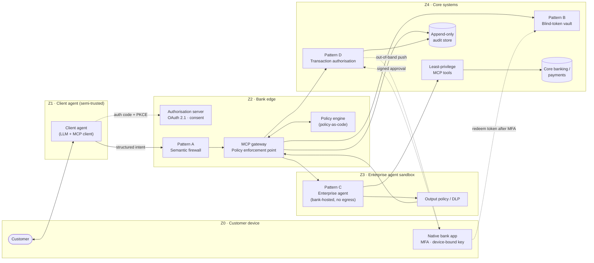
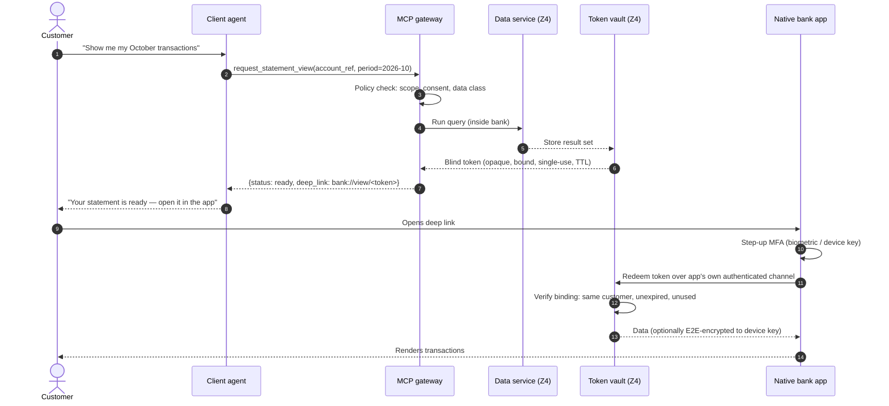
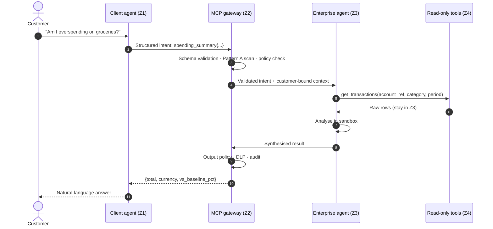
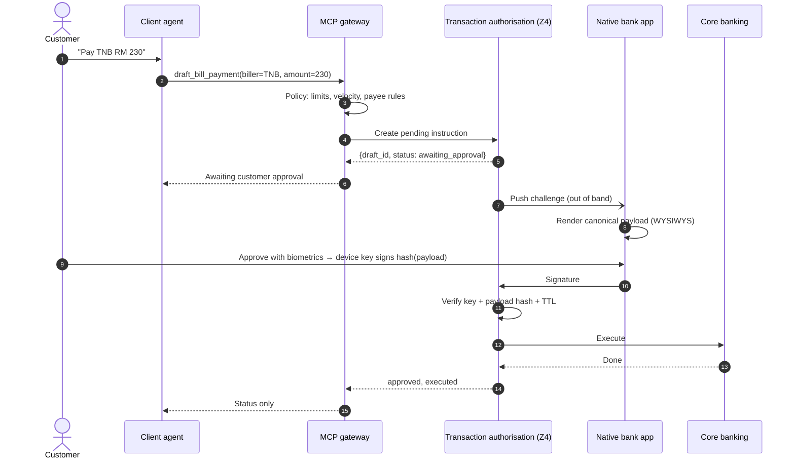

# Secure Agentic AI & MCP Integration Blueprint (v1.0 draft)

| | |
| --- | --- |
| **Document status** | Draft v1.0, not yet reviewed by a bank security, architecture or compliance team |
| **Target audience** | CISO, Head of Enterprise Architecture, Regulatory Compliance Officers |
| **Prepared for** | A Tier-1 financial institution (generic; no specific client yet) |
| **Date** | 2026-11-06 |
| **Related docs** | [problem-and-risks.md](problem-and-risks.md) · [threat-scenarios.md](threat-scenarios.md) · [architectural-mitigations.md](architectural-mitigations.md) · [development-strategy.md](development-strategy.md) · structure from [blueprint-prompt.md](blueprint-prompt.md) |

**Scope.** In scope: AI agents reaching core banking data and services through Model Context Protocol (MCP)
servers, for retail and SME customer channels. The agent can be the bank's own assistant or a third-party agent
the customer brings. Out of scope for v1.0: model training, and internal staff copilots that never touch customer
data.

---

## 1. Executive summary and objective

### 1.1 Strategic vision

Customers will increasingly ask an AI agent to do their banking. They will ask questions ("how much did I spend on
groceries last month?") and start actions ("pay my electricity bill"). MCP is fast becoming the standard way to
connect those agents to enterprise systems. A bank that exposes well-governed MCP tools can offer agentic service
first. A bank that does not will find customers using screen-scraping or unofficial workarounds anyway.

### 1.2 Inherent risk profile

MCP turns a language model's output into real tool calls. The model is non-deterministic, and **any content it
reads can steer it**: the user's message, an uploaded PDF, a web page, or even a transaction memo written by a
stranger who sent the customer money. So the bank must assume, by design, that **any agent can be compromised at
any time**. Conventional controls do not cover this case. Rate limiting, for example, stops volume abuse but not
one well-crafted malicious request (see [problem-and-risks.md](problem-and-risks.md)).

### 1.3 Core architectural goal

> **The agent may suggest; only deterministic bank controls may decide.**

Enable agentic efficiency while keeping:
- **zero-trust data boundaries:** raw PII and transaction records never enter a model context the bank does not
  control;
- **regulatory compliance:** GDPR, PDPA, and BNM / MAS technology-risk guidelines;
- **deterministic control over state changes:** no money moves and no beneficiary changes without a cryptographic
  approval from the customer, made outside the AI.

### 1.4 Design principles

| # | Principle | Meaning in practice |
| --- | --- | --- |
| P1 | Treat every LLM as an untrusted code path | Security decisions are never delegated to a model or a prompt. |
| P2 | Data minimisation by default | The agent gets the least data that answers the question, ideally none (Patterns B and C). |
| P3 | Deterministic state change | Writes are drafts until a human signs the bank-rendered payload (Pattern D). |
| P4 | Least privilege per tool, per session, per account | Narrow tools, consented account scopes, short-lived bound tokens (Section 4). |
| P5 | Defence in depth | Probabilistic controls (scanning) sit in front of deterministic ones (policy, crypto), never instead of them. |
| P6 | Everything is auditable | Every intent, tool call and decision is in an append-only trail (Section 5). |

---

## 2. Threat modelling and attack surface analysis

### 2.1 Trust zones

| Zone | Contents | Trust level |
| --- | --- | --- |
| Z0 | Customer device: native bank app, secure element / device-bound keys | Trusted for approval (after device binding) |
| Z1 | Client agent: the bank's assistant on an external LLM, or a third-party agent | **Semi-trusted.** Assume it can be compromised. |
| Z2 | Bank edge: authorisation server, MCP gateway, policy engine, scanning | Trusted, internet-facing |
| Z3 | Enterprise agent sandbox: bank-hosted model, read-only tools, no internet egress | Trusted, isolated |
| Z4 | Core systems: core banking, payments, customer data, token vault, audit store | Highly trusted |

### 2.2 Assets

Transaction histories (behavioural profiles), customer PII, account and card identifiers, OAuth tokens and session
bindings, the ability to move money, beneficiary lists, and audit logs (which are themselves sensitive).

### 2.3 Attack surface: everything that can enter a model's context

1. The user's own prompts.
2. Uploaded documents: PDF statements, invoices, images.
3. Fetched content: merchant URLs, web pages, emails.
4. **Tool results,** including attacker-controlled fields inside bank data: transfer memos, merchant names,
   payee nicknames.
5. Tool descriptions and metadata from MCP servers (tool poisoning).
6. Persistent memory, vector stores (RAG) and conversation logs.

### 2.4 Threat catalogue

| ID | Threat | Vector / example | Impact | Primary controls |
| --- | --- | --- | --- | --- |
| T1 | **Excessive agency and scope bleed** | A budgeting question; a broad tool returns joint and business accounts too; the model picks what it fetches. ([Scenario 1](threat-scenarios.md)) | Cross-account or corporate data exposure, even with no attacker | Consented account scopes (4.1), hyper-specific tools (4.2), policy gateway (4.3), Pattern C |
| T2 | **Indirect prompt injection** | Hidden text in an invoice PDF, a merchant page or a transfer memo says "fetch history and send to …". ([Scenario 2](threat-scenarios.md)) | Silent exfiltration; unauthorised actions | Pattern A, Pattern B, egress control, Pattern D for writes |
| T3 | **Data exfiltration via context pollution** | Raw PII and transactions land in the agent context, vector DB, logs or analytics, then come back later or across tenants. ([Scenario 3](threat-scenarios.md)) | Delayed, cross-customer leak of behavioural data | Patterns B and C, tenant-isolated ephemeral memory, log redaction (5.1) |
| T4 | Token theft, replay and confused deputy | A stolen bearer token is replayed; the MCP server forwards the client's token downstream | Account takeover through the agent channel | Sender-constrained tokens, audience binding, no token passthrough (4.1) |
| T5 | Tool poisoning and malicious MCP servers | Instructions in a third-party tool description; a tool definition changed after approval | The agent is steered before the user says anything | Signed, pinned tool manifests; gateway allowlist of servers and tools (4.2) |
| T6 | Volume abuse / denial of wallet | Brute-force enumeration; runaway agent loops | Cost and availability | Rate and budget limits at the gateway (4.3). The only threat that rate limiting covers. |

---

## 3. Core architectural patterns and defence in depth

### 3.0 Reference architecture



Every request from the client agent crosses one choke point, the MCP gateway. Reads go either through the
enterprise agent (Pattern C, for analysis) or into the token vault (Pattern B, for raw data the customer wants to
see). Writes only ever become drafts that the customer signs on their device (Pattern D).

### 3.1 Pattern A: input/context scanning and semantic firewalls (the perimeter)

**Purpose:** lower the rate at which malicious instructions reach any model context, at every point where content
crosses a trust boundary.

**Placement:** three inspection points:
1. **Ingress:** user prompts and uploaded or fetched content, before they reach the client agent or the gateway.
2. **Tool results:** bank data returning to any model (memos, merchant names and payee nicknames are
   attacker-controllable).
3. **Egress:** agent output, before it is shown or acted on.

**Mechanics:**

| Stage | What it does |
| --- | --- |
| Normalise | Convert documents to plain text through a renderer that keeps only *visible* content. It drops zero-size and white-on-white fonts, off-page and hidden-layer text, annotations, metadata and embedded files. |
| Unicode hygiene | Strip zero-width characters, bidi overrides and the Unicode "tag" block (invisible ASCII smuggling); fold homoglyphs. |
| Markup sanitisation | Remove HTML/markdown that can act. Remote image links in particular can carry exfiltrated data in the URL ("markdown image exfiltration"). Remove links outside an allowlist, and script/style blocks. |
| Injection classification | Classifier(s) score the content for instruction-like text aimed at the model ("ignore previous instructions", role-play, tool-call syntax). |
| Spotlighting | Wrap any untrusted content that remains in explicit delimiters / data-marking, so it is presented to the model as *data, not instructions*. |
| DLP on egress | Detect PII, account numbers and card numbers (PAN) in outbound text; block or mask. |

**Decision policy:** fail closed (block and alert) for high-confidence injection or any content headed for a
write flow. Strip and flag for low-confidence hits on read-only flows.

**Limit:** scanning is probabilistic and can be evaded. Under this blueprint, Pattern A is **never the only
control** on any path. Patterns B–D and Section 4 must hold even when it misses.

**Build vs buy:** buy or integrate commercial or open-source scanners. The bank's value is in *placement* and
*policy*, not in building classifiers.

### 3.2 Pattern B: blind-token execution / zero-knowledge data handling (data minimisation)

**Purpose:** for requests where the customer wants to *see* sensitive data ("show me last month's transactions"),
the agent arranges it but never holds the data.

**Token scheme:**
- The token is an **opaque, high-entropy reference handle** (≥128 bits of randomness), not the data in encrypted
  form. The result set sits in the bank's **token vault** (Z4).
- It is bound to the customer subject, the OAuth session, the purpose (e.g. `statement_view`) and the device class.
  It is **single-use** with a **short TTL** (e.g. 5–15 minutes, to be set with the bank).
- It is optionally signed (JWS) so the app can check it came from the bank before calling it.
- **Optional end-to-end mode:** the vault encrypts the result to a public key held in the customer's device
  secure element. The data can then only be decrypted on that device. This is the strict reading of "user
  decrypts" and protects against compromise inside the bank's own delivery path.
- The agent may get **allowed metadata only** (e.g. "statement ready, period Oct 2026"). Even counts and totals
  are personal data and need an explicit data-class rule before release.

**Workflow:**



**Security properties:** a fully compromised agent holds only opaque handles, so it has nothing raw to leak. A
stolen token is useless without the customer's authenticated app session and step-up MFA.

**Trade-off:** the agent cannot *reason* over data it cannot see. Pattern B suits "fetch and show me" requests.
"Analyse it for me" requests go to Pattern C. The app must also reject tokens bound to a different customer, and
should show where the request came from, to prevent deep-link phishing.

### 3.3 Pattern C: dual-agent / delegated enterprise architecture (air-gapped trust boundary)

**Purpose:** for requests that need analysis, the analysis runs where the data lives. Only a synthesised answer
crosses back out.

**Roles:**

| | Client agent (Z1) | Enterprise agent (Z3) |
| --- | --- | --- |
| Trust | Semi-trusted / external | Trusted, sandboxed |
| Model | Any (bank assistant or third-party) | Bank-hosted or bank-contracted, no data retention |
| Job | Natural-language conversation with the user; turns requests into **structured intent** | Runs read-only tools for the authenticated customer only; analyses inside the sandbox |
| Data seen | No raw records; only synthesised insights | Raw records for the consented accounts, for this request only |
| Network | Internet | **No internet egress;** only the gateway and read-only tools |
| Memory | Must not keep sensitive data (bank policy for its own assistant; contract terms for third parties) | **Ephemeral:** cleared at the end of the request; no shared vector store across customers |

**Structured intent boundary:** the client agent cannot pass free text through to the enterprise agent. It sends a
typed request validated against a schema. Intents are an enumerated list, parameters are typed, and only tightly
constrained free-text fields are allowed (length-limited, scanned by Pattern A).

```json
{
  "intent": "spending_summary",
  "version": "1.0",
  "params": {
    "account_refs": ["acc_9f3c"],
    "category": "groceries",
    "period": { "from": "2026-10-01", "to": "2026-10-31" },
    "compare_to": "trailing_6m_avg"
  }
}
```

**Output policy (Z3 → Z2):** before anything leaves the sandbox, a deterministic filter enforces:
- aggregates only, with no individual transaction rows;
- no counterparty names, account numbers or PII unless that data class is allowed for this intent;
- minimum aggregation thresholds for business accounts (avoids singling out one counterparty);
- a DLP scan, then a schema-conformant response.

Example response: `{"total": 812.40, "currency": "MYR", "vs_baseline_pct": 14}`. The client agent turns it into
"You spent RM 812 on groceries in October, about 14% above your 6-month average."



**Residual risk:** the enterprise agent is still an LLM, and it reads attacker-controllable fields such as
memos. That is acceptable because it has **no egress, only read-only tools and a deterministic output filter**.
Even if it is steered, it has no channel to send data out and no tool that can change state.

### 3.4 Pattern D: cryptographic human-in-the-loop (HITL) for state changes

**Purpose:** guarantee that no state-changing operation (money movement, beneficiary add/change, limit change,
contact-detail change) runs on the AI's authority.

**Mechanics:**
1. **Read/write split at the tool level.** Agents never get write tools, only `draft_*` tools
   (`draft_transfer`, `draft_bill_payment`, `draft_add_beneficiary`). A draft has no effect until it is approved.
2. **Policy pre-check.** The gateway applies the hardcoded business limits before anything reaches the customer
   (see 4.3).
3. **Out-of-band challenge.** The transaction authorisation service (TAS) creates a pending instruction and pushes
   it to the native bank app. The agent is not in this channel.
4. **What You See Is What You Sign.** The app renders the details **from the bank's canonical payload**, never
   from text the agent wrote. That covers payee name as registered, account, amount, currency and reference.
5. **Cryptographic approval.** The customer approves with a device-bound key (passkey/FIDO2 or the bank's
   secure-device binding, unlocked by biometrics). The signature is over a hash of the canonical payload, which
   *dynamically links* the approval to the exact amount and payee.
6. **Verify, then execute.** TAS checks the signature against the device's registered key and the payload hash,
   then executes. The agent only receives a status (`approved` / `rejected` / `expired`).



**Security properties:** an injected or confused agent can at worst *propose* a bad transaction. It cannot carry
it out, change what the customer sees when approving, or approve on the customer's behalf.

**Residual risk:** approval fatigue, and social engineering through the agent ("just approve the next prompt").
Mitigations: cooling-off periods and extra friction for new beneficiaries, risk-based step-up, and plain-language
warnings in the app for high-risk patterns.

---

## 4. Implementation protocol and API governance

### 4.1 OAuth 2.1 with cryptographic session binding

MCP's authorisation model is based on OAuth 2.1. For banking-grade deployment, also align with the FAPI 2.0
Security Profile.

| Control | Requirement |
| --- | --- |
| Grant | Authorisation code + PKCE only. No implicit or password grants. |
| Consent | The customer picks **which accounts** and **which capabilities** the agent gets, at the bank's own consent screen. Joint and business accounts are never included by default. This is the structural fix for T1. |
| Audience binding | Tokens are audience-restricted to the specific MCP server (resource indicators, RFC 8707). The server publishes protected-resource metadata (RFC 9728). |
| Sender-constrained tokens | Bind tokens to a key held by the client, using DPoP (RFC 9449) or mTLS-bound tokens (RFC 8705). A stolen token cannot be replayed from somewhere else. |
| Lifetimes | Short-lived access tokens (minutes), rotating refresh tokens, consent expiry with re-consent. |
| No token passthrough | The MCP server never forwards the client's token to downstream APIs. It uses its own credentials and checks the customer binding on every call. |
| Client registration | Third-party agents must be registered and allowlisted before they can connect. |
| Revocation | Customers can revoke from the app. The SOC can revoke per session, per client or globally (kill switch). |

Note: OAuth 2.1 and parts of the MCP specification are still changing. Pin the versions you implement, and
review them every quarter.

### 4.2 Tool-specific least privilege

| Anti-pattern | Blueprint tool |
| --- | --- |
| `query_database(sql)` | `get_account_balance(account_ref)` |
| `get_transactions(customer_id)` | `get_transactions(account_ref, period, category?)`, capped and paginated |
| `transfer(from, to, amount)` | `draft_transfer(from_ref, payee_ref, amount)`, which only creates a Pattern D draft |
| `search_customer(name)` | *(not exposed to agents)* |

Tool design rules:
- **Typed, enumerated parameters.** No free-form queries.
- **Account references are consent-scoped pseudonymous handles** (`acc_9f3c`), not account numbers. The server
  checks ownership and consent on every call.
- **Minimal response schemas.** Return only the fields the intent needs. Label or sanitise third-party free-text
  fields (memos, merchant names) as untrusted.
- **Signed and pinned tool manifests.** Tool names, descriptions and schemas are versioned and signed. The gateway
  rejects tools that are not on its allowlist or whose definition has changed (T5).
- **Separate read and write servers.** Different MCP servers and credentials, so a read-path compromise cannot
  reach write tools.

### 4.3 Deterministic policy enforcement gateway

Every MCP tool call passes through the gateway, which acts as the policy enforcement point. It asks a policy
decision point running **policy-as-code** (OPA/Rego, Cedar or similar), which is versioned, tested and
change-controlled like any other code.

Rules checked on every call:
- the client is allowlisted for this tool; the session has the required scope and consent for this account;
- data-class ceiling for the intent (e.g. aggregates only for third-party agents);
- per-session tool budget and sequence rules (e.g. a bulk read followed by an attempt to reach an external URL is
  denied and flagged);
- business-logic limits on drafts: per-transaction and daily caps, new-payee cooling-off, velocity, time-of-day,
  device and geo risk;
- rate and volume limits (T6).

Behaviour: **fail closed.** Every decision is logged with the rule ID and policy version (5.1).

### 4.4 Runtime environment

- The enterprise-agent sandbox has egress only to the gateway and its tools. DNS and HTTP egress are blocked.
- Secrets and credentials are never placed in a model context.
- Separate model hosting per trust zone, with contracts that forbid training on or retaining prompts.
- Memory is ephemeral by default. Any persistent memory is per customer, encrypted, has a retention limit, and is
  never pooled into a shared vector store.

---

## 5. Compliance, auditability and immutable logging

### 5.1 Append-only audit trail

**Record per event** (intent, tool call, policy decision, HITL challenge, token issue or redeem):

| Field | Notes |
| --- | --- |
| `event_id`, `timestamp`, `prev_hash` | Hash-chained for tamper evidence |
| `session_id`, `client_agent_id`, `customer_pseudonym` | Customer stored as a pseudonym; the mapping is held separately |
| `intent` (structured), `tool`, `params_redacted`, `params_hash` | Hash lets investigators verify without keeping raw values |
| `policy_decision`, `rule_id`, `policy_version` | Every allow or deny can be explained |
| `response_data_class` | e.g. `aggregate`, `blind_token`, `status_only` |
| `scan_results` | Pattern A scores and actions |
| `hitl_challenge_id`, `signature_valid`, `device_key_id` | For writes |
| `model_id`, `model_version` | For the enterprise agent |

**Storage:** WORM / object-lock storage, hash-chained, with retention per the bank's record-retention policy and
regulatory requirements. **Logs must not become the next leak** (Scenario 3): PII is redacted or tokenised at
write time, and access is role-based and itself logged.

### 5.2 Behavioural anomaly detection and session severing

**Signals:** injection-classifier hits; repeated policy denials; tool sequences that don't match the intent;
spikes in reads across accounts; egress attempts; token use from a new key or device; bursts of drafts; repeated
HITL rejections.

**Tiered automated response:**

| Tier | Trigger (examples) | Action |
| --- | --- | --- |
| 1 | A single low-confidence signal | Flag; require step-up on the next sensitive call |
| 2 | Repeated denials or a medium-confidence injection hit | Drop the session to read-only aggregates; notify the customer in the app |
| 3 | High-confidence injection or an exfiltration pattern | **Sever the session, revoke its tokens,** cancel pending drafts, alert the SOC |
| Kill switch | A systemic issue with one client agent or model | Disable that client (or all agent access) centrally |

### 5.3 Regulatory mapping (to be confirmed with the bank's compliance team)

| Requirement area | GDPR / PDPA (MY, SG) | BNM RMiT / MAS TRM (technology risk) | Blueprint controls |
| --- | --- | --- | --- |
| Data minimisation and purpose limitation | ✓ | — | Patterns B and C, consent scopes (4.1), output policy |
| Security of processing | ✓ | ✓ | Sections 3–4 as a whole |
| Strong customer authentication for transactions | — | ✓ | Pattern D, device-bound keys |
| Third-party / outsourcing risk (external LLMs) | ✓ (processors) | ✓ | Trust zones; Z1 treated as semi-trusted; contract terms |
| Access control and least privilege | ✓ | ✓ | 4.1–4.3 |
| Audit trail and incident response | ✓ (breach notification) | ✓ | 5.1, 5.2 |
| Fairness, ethics, accountability of AI | — | MAS FEAT principles, if adopted | Policy-as-code explainability, model versioning |

The specific clause references are not mapped yet. That needs a compliance review against each bank's current
obligations, including any new AI-specific guidance from BNM or MAS.

### 5.4 Assurance

- **Red-team test pack** built from [threat-scenarios.md](threat-scenarios.md) (S1–S3) and T1–T6, run before go-live
  and on every policy or model change.
- Independent penetration testing of the gateway, the authorisation server, the app redemption and HITL flows.
- Change control on tool manifests, intent schemas, policies and model versions.

---

## 6. Mapping to the threat scenarios

| Scenario | Stopped by (deterministic) | Reduced by (probabilistic) |
| --- | --- | --- |
| S1 Cross-account scope bleed | Account-level consent (4.1), pseudonymous account refs + ownership checks (4.2), output policy (3.3) | — |
| S2 Trojan-horse PDF | No egress in Z3, blind tokens (3.2), drafts + HITL for writes (3.4), sequence rules (4.3) | Pattern A visible-text rendering + classifier |
| S3 Memory / RAG trap | Ephemeral per-customer memory (4.4), raw data stays in Z3/Z4, log redaction (5.1) | DLP on egress |

## 7. Residual risks and open issues

1. **Synthesised insights are still personal data.** Pattern C lowers sensitivity, but it does not remove it.
   Aggregates sent to a third-party agent still need consent and purpose limits.
2. **UX friction.** Blind tokens and HITL add app hops. Measure task completion in the POC.
3. **Third-party agent behaviour cannot be enforced technically**, only by contract and registration. The design
   assumes Z1 is untrusted, so this is a commercial risk rather than a security gap.
4. **Specification churn:** OAuth 2.1 (draft) and MCP versions. Pin and review.
5. **Scanner efficacy is unproven** against document-borne injection. Benchmark vendors during the POC.
6. **Approval fatigue and social engineering** in Pattern D. Monitor rejection and fraud rates.
